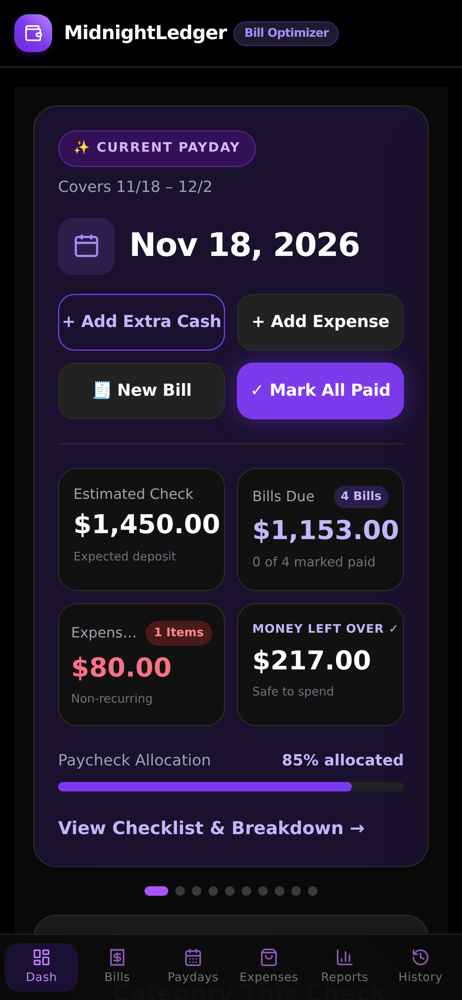
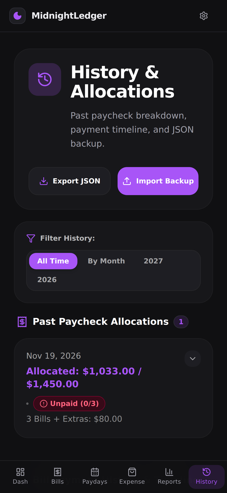

# 🌙 MidnightLedger ✨💜

Dark-mode budget app for paycheck-to-paycheck planning 🌃 Built for split bills, irregular paydays, and tax estimates 💸📊

### 🚀 Live Demo
→ https://midnightledger.justicegraff6.workers.dev ✨

### 📲 Download
- 🤖 Android APK: [v3.2.0 Offline Edition](https://github.com/MidnightRaven9/MidnightLedger/releases/tag/v3.2.0) 🔒✨ — **100% offline, no server or internet needed** 📵💾
- 📱 PWA: Open live demo → Add to Home Screen

---

### 🗑️ How to Remove Sample Data

If you see sample bills after installing:

1. Open the app → Go to **History**
2. Scroll to the **very bottom** of the page
3. Tap **Wipe All Data** → Confirm

This clears all sample/demo bills and gives you a fresh start. Everything is stored locally on this device (localStorage).

---

### 🌟 Features

- 📅 **Flexible Pay Periods** - Biweekly, semi-monthly, or custom dates (Aug 15, Aug 29, Sep 12...) 🗓️
- 👥 **Split Bills** - Assign bills to specific paychecks, split between people (my portion vs total) 🤝💰
- 🧮 **Tax Estimates** - Quick estimate on checks before they hit 💵
- 💳 **Paycheck Allocation** - See available after bills: `$1,450 available • 3 bills assigned` 💜
- 💸 **Expenses & Reports** - Track spending per paycheck cycle 📈📉
- 🔔 **Bill Reminders** - Bell with due-soon count badge, one-tap mark-paid, and optional local Android notifications (configurable days-ahead) — all on-device ⏰
- 🕰️ **History** - Past paycheck allocations 📚
- 📵 **100% Local-First** - No trackers, no cloud, no account — everything stays on your device 🏠
- 🌑 **Dark Theme** - Near-black surfaces with a purple #a855f7 accent, PWA installs as "MidnightLedger" 🌙💜
- 🎨 **Custom Accent Colour** - Pick from presets, a hex code, or a colour wheel — applies to the UI **and** confetti, saved locally (⚙️ gear in the header)

### 📸 Screenshots

Captured on a fresh install (sample data, 390×844). Regenerate with `npm run screenshots` after `npm run build` + `npm run preview`.

| 📊 Dashboard | 🧾 Bills | 📅 Paydays |
|:---:|:---:|:---:|
|  |  |  |
|  <br/> 💸 **Expenses** |  <br/> 📈 **Reports** |  <br/> 🕰️ **History** |

### 🛠️ Tech Stack

- ⚛️ React + TypeScript 💙
- 🎨 Tailwind CSS + shadcn/ui ✨
- ⚡ Vite 🚀
- 📲 PWA-ready 📱
- ☁️ Cloudflare Workers + D1 + KV

### 🏁 Getting Started

```bash
git clone https://github.com/MidnightRaven9/MidnightLedger.git
cd MidnightLedger
npm install
npm run build
```

### 🎨 App Icon

🌙 Horizontal gradient fill — purple #7C3AED → #A855F7 → #C084FC on #101012 rounded square with ledger lines

Every icon and splash (web, PWA, Android mipmaps, adaptive foregrounds, splashes) is generated from a single SVG in `scripts/generate-icons.mjs` — regenerate any time with:

```bash
node scripts/generate-icons.mjs
```

Files: `/public/icon-512.png`, `/public/icon-192.png`, `/public/apple-touch-icon.png`, `/public/favicon.png`, `android/app/src/main/res/mipmap-*/` 🖼️

Manifest sets name to `MidnightLedger` so it installs with correct name and icon on iOS/Android 📲✨

### ☕ Support

Built and maintained by [MidnightRaven9](https://github.com/MidnightRaven9) in the open — free forever, no ads, no tracking. If MidnightLedger helped you, you can [buy me a coffee](https://github.com/sponsors/MidnightRaven9) ☕ or just ⭐ the [repo](https://github.com/MidnightRaven9/MidnightLedger).

### 📄 License

MIT © 2026 MidnightRaven9 💜🌙
