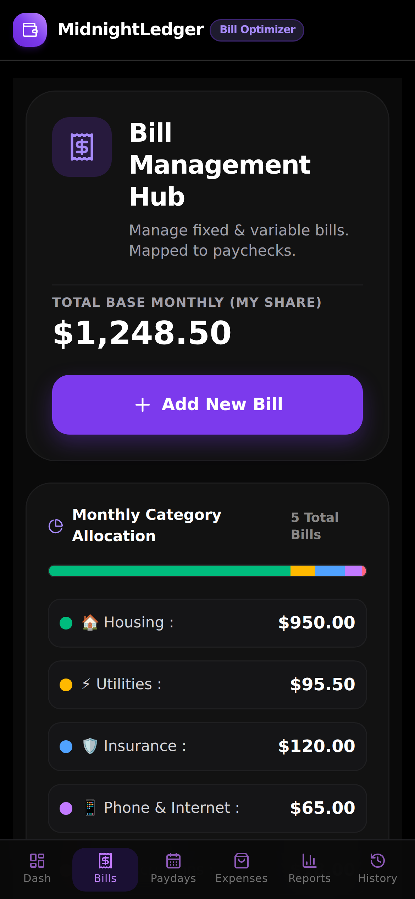
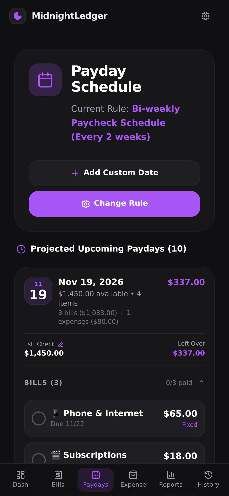
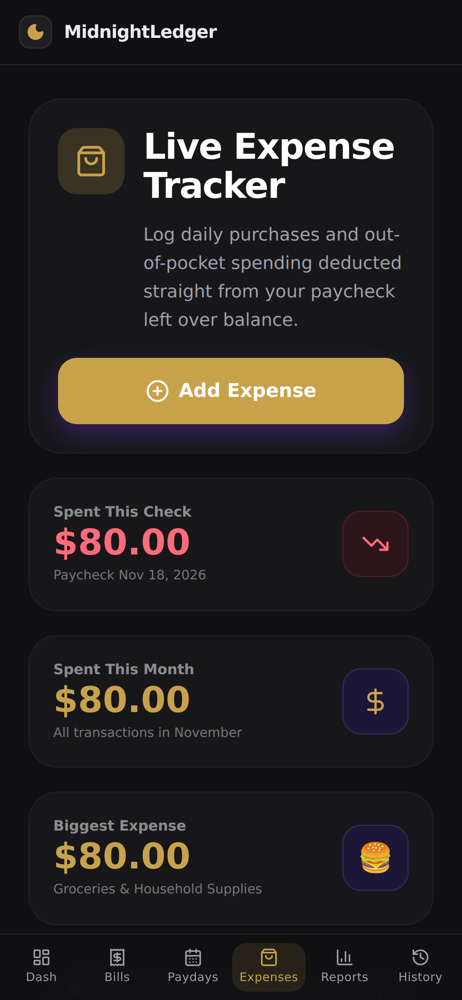
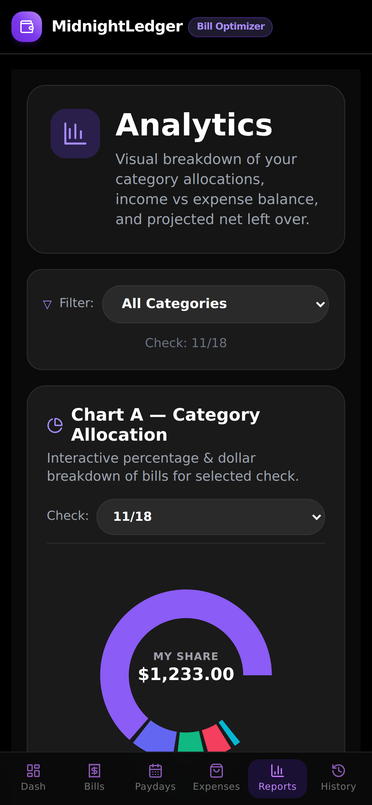

# MidnightLedger

Offline-first budgeting for people who live paycheck to paycheck. Plan irregular paydays, split bills, estimate tax, and see what is actually left to spend — without an account or a network connection.

[](LICENSE)
[](https://github.com/MidnightRaven9/MidnightLedger/actions/workflows/ci.yml)
[](https://github.com/MidnightRaven9/MidnightLedger/releases/latest)
[](#installation)
[](#development)

## Features

- Flexible pay schedules — biweekly, semi-monthly, or explicit dates such as Aug 15 and Aug 29
- Bill splitting with a personal share versus the full amount, assigned to specific paychecks
- Per-paycheck allocation showing available cash after bills
- Quick tax estimates on incoming checks
- Expense tracking and category reports
- Bill reminders with a due-soon badge, one-tap mark-paid, and opt-in local Android notifications
- Custom accent colour for the interface and celebration confetti, saved on the device
- No account, no telemetry, no network calls — all data stays in local storage

## Installation

### Android

1. Download the latest [offline APK](https://github.com/MidnightRaven9/MidnightLedger/releases/latest) from Releases.
2. Enable "Install unknown apps" for your browser or file manager when prompted.
3. Open the APK and install it.
4. If sample data appears, open **History**, scroll to the bottom, and tap **Wipe All Data**.

The APK is debug-signed for sideloading. It needs no internet connection at runtime.

### Web / PWA

Open the [live demo](https://midnightledger.justicegraff6.workers.dev) and use your browser's "Add to Home Screen" option. The demo is static hosting only; the app itself makes no network requests.

## Usage

1. Add bills with an amount, due day, category and optional split.
2. Set a pay schedule in **Paydays** — choose a recurring rule or enter exact dates.
3. Check **Dashboard** for the current paycheck, bills due, and remaining cash.
4. Mark bills paid as checks arrive. **History** keeps past allocations.
5. Open **Settings** (gear icon) to change the accent colour or configure reminders.

Everything is stored locally. Clearing app data or uninstalling removes it permanently.

## Screenshots

Captured from a fresh install with sample data. To replace them, run `npm run screenshots` after `npm run build` and `npm run preview`, then save the files in `docs/screenshots/` using the exact names below.

| Dashboard | Bills | Paydays |
|:---:|:---:|:---:|
|  |  |  |
|  |  |  |

## Development

Requires Node.js 20 or newer.

```bash
git clone https://github.com/MidnightRaven9/MidnightLedger.git
cd MidnightLedger
npm install
npm run dev
```

`npm run dev` starts the local server on `http://127.0.0.1:3000`. Other commands:

| Command | Purpose |
| --- | --- |
| `npm run lint` | Type-check with TypeScript |
| `npm run build` | Build the web app and development server into `dist/` |
| `npm run preview` | Serve the built web app on port 4173 |
| `npm run screenshots` | Regenerate the screenshots in `docs/screenshots/` |
| `npm start` | Run the built server (requires `npm run build` first) |

See [CONTRIBUTING.md](CONTRIBUTING.md) for the contribution workflow and [docs/](docs/) for additional notes.

## App icon

All icons and splash screens are generated from `scripts/generate-icons.mjs`. After editing the generator, run:

```bash
node scripts/generate-icons.mjs
```

This updates the PWA icons in `public/` and the Android mipmaps and adaptive icons in `android/app/src/main/res/`.

## Support

MidnightLedger is free and open source, with no ads or tracking. If it helps you, you can [sponsor the project](https://github.com/sponsors/MidnightRaven9) or star the [repository](https://github.com/MidnightRaven9/MidnightLedger).

## License

MIT © 2026 MidnightRaven9. See [LICENSE](LICENSE).
